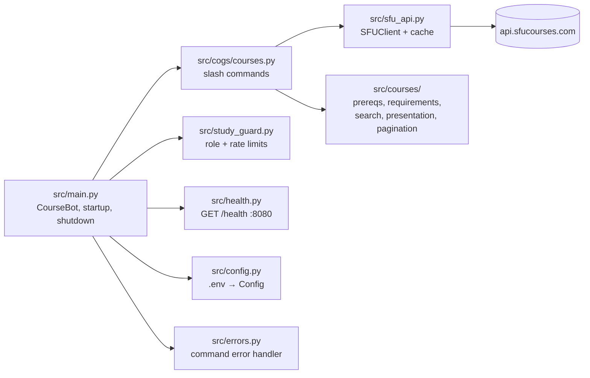

# SFU CourseBot

A Discord bot that answers questions about SFU courses: course details, who teaches what, what a course unlocks, and which courses fit a requirement. It also runs **Study Guard**, which gives members a role while they're in the study-time voice channel, giving message access to the connected text channel.

Course data comes from the [SFU Courses API](https://api.sfucourses.com/).

### ---->  [Invite the bot to your server!](https://discord.com/oauth2/authorize?client_id=1429023672772853841)

## Commands

| Command                                                             | Purpose                                                                                                                                                      | Example                                         |
| ------------------------------------------------------------------- | ------------------------------------------------------------------------------------------------------------------------------------------------------------ | ----------------------------------------------- |
| `/course <subject> <course_number>`                                 | To search for a specific course. Provides title, credits, description, prerequisites and the 4 most recent offerings with instructors.                       | `/course CMPT 225`, `/course CMPT 105W`         |
| `/offerings <instructor_name> [term]`                               | To search for all course offerings that an instructor has taught, one page per year (newest first). Filterable by`term`, e.g. `fall` or `spring 2026`        | `/offerings Brian Fraser`                       |
| `/unlocks <dept> <number>`                                          | Finds other courses that list the searched course as a prerequisite.                                                                                         | `/unlocks CMPT 225`                             |
| `/find [requirement] [dept] [level] [delivery] [no_prereqs] [term]` | To search for undergraduate courses matching every filter you give (at least one). `requirement` is a WQB designation, `term` is *This term* or *Next term*. | `/find requirement:Writing (W) level:300-level` |
| `/reviews <instructor_name>`                                        | Prints an instructor's RateMyProfessors summary.                                                                                                             | `/reviews Brian Fraser`                         |

Notes:

- `/offerings` only shows terms where SFU has listed the instructor. if an upcoming terms doesnt have an instructor yet,  they may appear at a later date.

## Study Guard

Study Guard watches one voice channel (study time):

- Joining the channel gives you the study-time role, which unlocks the study-time text chat, and leaving removes it.
- Joining too often or making many very short visits blocks the role for a while. The member gets a DM with the wait time and moderators get a report.
- On startup and every reconnect, the bot re-syncs the role: everyone in the channel has it, nobody outside does.

### Setup in your server:

1. Create the study-time role.
2. Give the bot **Manage Roles** and move the bot's role **above** the study-time role.
3. Set the channel ids and role name in `.env` (see [Configuration](#configuration)).

## How it's built



- `src/courses/` holds pure functions (no Discord, no network), so most tests run without either.
- `SFUClient` caches instructor reviews for 1 hour and the full outline list for 24 hours.
- Python 3.13, [discord.py](https://discordpy.readthedocs.io/) 2.7, aiohttp.

## Local development

You need Python 3.13 and a **separate dev bot** (its own application in the [Discord Developer Portal](https://discord.com/developers/applications)).

In the Developer Portal, under **Bot → Privileged Gateway Intents**, turn on **Server Members**. Message Content isn't needed.

```bash
python3.13 -m venv venv
```

```bash
source venv/bin/activate
```

```bash
pip install -r requirements-dev.txt
```

```bash
cp .env.template .env
```

Fill in `.env` with the dev bot's token and your test server's ids, then run:

```bash
python -m src.main
```

Or in Docker, which matches production:

```bash
docker compose up --build
```

Press Ctrl+C once to stop; the bot shuts down cleanly.

## Configuration

Everything is read from environment variables (`.env` locally, App Runner settings in production).

| Variable | Required | Default | Meaning |
|---|---|---|---|
| `DISCORD_TOKEN` | yes | | Bot token |
| `GUILD_ID` | yes | | Server Study Guard runs in |
| `STUDY_TIME_VC_CHANNEL_ID` | yes | | Study-time voice channel |
| `STUDY_TIME_TEXT_CHANNEL_ID` | yes | | Channel for startup and restart notices |
| `MODERATION_REPORT_VC_CHANNEL_ID` | yes | | Channel for moderation reports |
| `STUDY_TIME_ROLE_NAME` | yes | | Name of the study-time role |
| `STUDY_TIME_VC_JOIN_LIMIT_COUNT` | no | 5 | Joins allowed per window |
| `STUDY_TIME_VC_JOIN_LIMIT_WINDOW_SECONDS` | no | 60 | Join-limit window |
| `STUDY_TIME_VC_SHORT_STAY_SECONDS` | no | 30 | Visits shorter than this count as short |
| `STUDY_TIME_VC_SHORT_STAY_THRESHOLD` | no | 5 | Short visits allowed per window |
| `STUDY_TIME_VC_SHORT_STAY_WINDOW_SECONDS` | no | 120 | Short-stay window; must be longer than the short-stay time |
| `CLEANUP_INTERVAL_SECONDS` | no | 600 | How often old join history is cleared |

The bot wont start if a required value is missing or a number isn't a positive integer.

## Linter Check

```bash
ruff check .
```

```bash
ruff format --check .
```

```bash
python -m pytest
```

CI runs these three by default. Pytest tests use saved real API responses in `tests/fixtures/` and a local aiohttp test server, so they don't touch the network or Discord.

## Deployment

Every push to `main` deploys automatically (`.github/workflows/ci-cd.yaml`):

1. **Test:** ruff and pytest, where a failure stops the deploy.
2. **Build:** GitHub Actions signs in to AWS with OIDC (no stored AWS keys), builds the Docker image and pushes it to ECR tagged with the commit SHA.
3. **Deploy:** points the App Runner service at the new image and waits until the deployment succeeds or fails.

App Runner checks `GET /health` on port 8080. The container runs as a non-root user.

Repository settings the workflow needs:

- Secrets: `AWS_ROLE_ARN`, `APP_RUNNER_SERVICE_ARN`
- Variables: `AWS_REGION`, `ECR_REPOSITORY_NAME`

**During a deploy** the old and new copies are both online for several minutes. The new copy posts a startup notice in the study-time text channel; the old copy sees it and stops handling commands and Study Guard, so nothing is answered twice.

**Monitoring:** a CloudWatch metric filter counts `ERROR` log lines, and an alarm emails through SNS when any appear.

## Contributing

1. Branch off `main`.
2. Make the change, with a test for any new logic.
3. Run the three checks under [Tests](#tests) and try it against your dev bot.
4. Open a pull request to `main`, merging will deploy it.

## Acknowledgements

- [SFU Courses API](https://api.sfucourses.com/) by Brian Rahadi, the source of all course data.

## Contributors

- [@smehars](https://www.github.com/smehars)
- [@kylesaburao](https://github.com/kylesaburao)

Feedback or questions: meharsaini@hotmail.com
